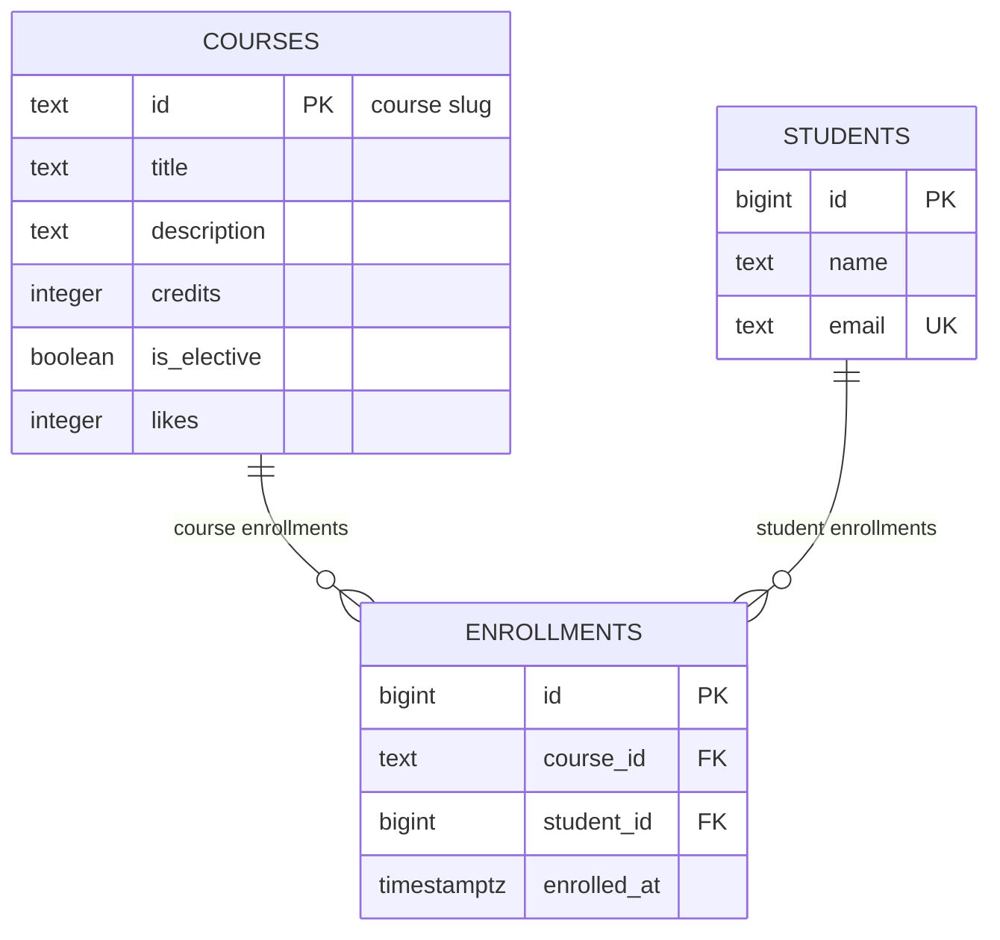

# course-catalog-db

PostgreSQL schema for the course catalog (Lab 6, Advanced Web Technologies).

## How to run

PostgreSQL 16 or newer is required. Once as the postgres superuser run this:

```sql
CREATE ROLE catalog_app LOGIN PASSWORD 'change-me';
CREATE DATABASE course_catalog OWNER catalog_app;
```

Then from the project folder run these commands. The flag stops execution at the first error:

```bash
psql -h localhost -U catalog_app -d course_catalog -v ON_ERROR_STOP=1 -f schema.sql
psql -h localhost -U catalog_app -d course_catalog -v ON_ERROR_STOP=1 -f seed.sql
psql -h localhost -U catalog_app -d course_catalog -v ON_ERROR_STOP=1 -f queries.sql
```

The password change-me is for teaching. Real projects keep passwords out of git.

## Schema



The schema has three tables. Courses and students have a many to many relationship. We use the enrollments table to connect them. An enrollment has one course and one student.

## Design decisions

Why courses.id is text and students.id is an automatic number. A text slug is good for URLs and it is easy to read. An automatic number is good for internal IDs when users do not need to see them.

Why RESTRICT on course_id and CASCADE on student_id. We use RESTRICT to prevent accidental deletion of a course that has enrollments. We use CASCADE for students because if a student leaves we want to delete their enrollments automatically.

Why timestamptz and text. We use timestamptz to store the exact moment in time with the timezone. It is safer for global apps. We use text because it works as fast as varchar and we do not need to limit the length.

## Constraint violation log

Commands were run with `\set VERBOSITY verbose`.

| # | What we violate | SQLSTATE | Constraint | API response |
|---|-----------------|----------|------------|--------------|
| 1 | NULL in courses.title | 23502 | NOT NULL (title) | 422 |
| 2 | courses.credits = 0 | 23514 | courses_credits_check | 422 |
| 3 | courses.likes = -1 | 23514 | courses_likes_check | 500 |
| 4 | a one-letter student name | 23514 | students_name_check | 422 |
| 5 | a duplicate student email | 23505 | students_email_key | 409 Conflict |
| 6 | a duplicate course id | 23505 | courses_pkey | 409 Conflict |
| 7 | a repeated enrollment in a course | 23505 | enrollments_course_id_student_id_key | 409 Conflict |
| 8 | enrolling in a nonexistent course | 23503 | enrollments_course_id_fkey | 404 |
| 9 | enrolling a nonexistent student | 23503 | enrollments_student_id_fkey | 404 |
| 10 | deleting a course that has enrollments | 23001 | enrollments_course_id_fkey | 409 Conflict |
| 11 | deleting a student (cascade) | - | ON DELETE CASCADE | 200 OK |

**Pydantic question:**
Pydantic already checks the name length (min_length=2) in our API. Why duplicate this in the database. The database is the last line of defense. Pydantic only protects our API but if someone else (such as another service a script or an administrator) decides to write data directly to the database Pydantic will no longer work. Constraints within the database itself ensure that no one will ever be able to violate the rules regardless of how the data gets there.

## Index: EXPLAIN before and after

Query: `SELECT * FROM enrollments WHERE student_id = 777;`
Database idx_demo: 500 courses, 20,000 students, 50,000 enrollments.

| | Before the index | After the index |
|---|---|---|
| Access method | Seq Scan | Bitmap Index Scan |
| cost | 0.00..1042.00 | 4.31..15.59 |
| Rows Removed by Filter | 49997 | - |
| Execution Time | 1.949 ms | 0.176 ms |

**Plans:**

```sql
-- Before the index
Seq Scan on enrollments  (cost=0.00..1042.00 rows=3 width=34) (actual time=0.057..1.934 rows=3.00 loops=1)
  Filter: (student_id = 777)
  Rows Removed by Filter: 49997
  Buffers: shared hit=417
Planning Time: 0.082 ms
Execution Time: 1.949 ms
```

```sql
-- After the index
Bitmap Heap Scan on enrollments  (cost=4.31..15.59 rows=3 width=34) (actual time=0.149..0.152 rows=3.00 loops=1)
  Recheck Cond: (student_id = 777)
  Heap Blocks: exact=3
  Buffers: shared hit=6 read=2
  ->  Bitmap Index Scan on enrollments_student_id_idx  (cost=0.00..4.31 rows=3 width=0) (actual time=0.135..0.135 rows=3.00 loops=1)
        Index Cond: (student_id = 777)
        Index Searches: 1
        Buffers: shared hit=3 read=2
Planning Time: 0.136 ms
Execution Time: 0.176 ms
```

**Answers to the questions:**
1. Why didn't PostgreSQL create an index on `enrollments.student_id`, although there are indexes on `email` and `course_id`? PostgreSQL creates indexes automatically only for PRIMARY KEY and UNIQUE constraints. Foreign keys like student_id do not get automatic indexes because they do not guarantee uniqueness. The course_id has an index because it is the first column in the UNIQUE constraint for the pair of course_id and student_id.
2. Why does a primary-key lookup on `courses` (six rows) use `Seq Scan`, while on `enrollments` (50 thousand rows) it goes through an index? The query planner compares the cost of different ways to get data. The courses table takes just one memory page because it has only six rows. Reading the whole table is faster and cheaper than using an index. For the enrollments table with fifty thousand rows reading the whole table is too expensive so the planner uses an index.
3. Name two operations that an index on `student_id` will speed up. First it speeds up finding all enrollments for a specific student. Second it speeds up deleting a student because the database uses the ON DELETE CASCADE rule to quickly find and remove all records of that student in the enrollments table.

## Transaction

Scenario: enroll a new student in a course with two inserts in one transaction.

**The second insert failed:**
When I tried to insert a student and then enroll them in a nonexistent course the second insert failed with an error. The psql prompt changed to `!` which means the transaction was aborted. After that even a simple SELECT command failed with a message that the transaction is aborted. When I ran ROLLBACK the first insert was also undone and the student was not in the database. This shows that a transaction applies either all commands or none.

**Two windows experiment:**
Window A started a transaction and did two inserts but did not commit them. Window B saw zero rows for the new student before the COMMIT. This happens because the default isolation level is read committed. Changes are invisible to other clients until they are saved. After Window A ran COMMIT Window B saw the new student immediately.

**What would have happened without a transaction if the second insert had failed?**
Without a transaction if the second insert had failed the first insert would have stayed in the database. We would have a student with no enrollment which is a half finished operation. Transactions protect us from this problem.

## Self-review against the checklist

| What to check | Result | Comment |
|---|---|---|
| Keys | Yes | Every table has a primary key. We have foreign keys for all relationships. |
| Types | Yes | IDs are bigint and text. Time is timestamptz. Numbers are integers. |
| Required values | Yes | We used NOT NULL for all required fields like title, name and email. |
| Constraints | Yes | We used CHECK for credits, likes and name length. We used UNIQUE for email and course pairs. |
| Deletion | Yes | We chose RESTRICT for courses and CASCADE for students on purpose. |
| Normalization | Yes | We split data into three tables to avoid anomalies. No lists in a single cell. |
| Indexes and names | Yes | We added an index on student_id for fast lookups. All names use snake_case. |